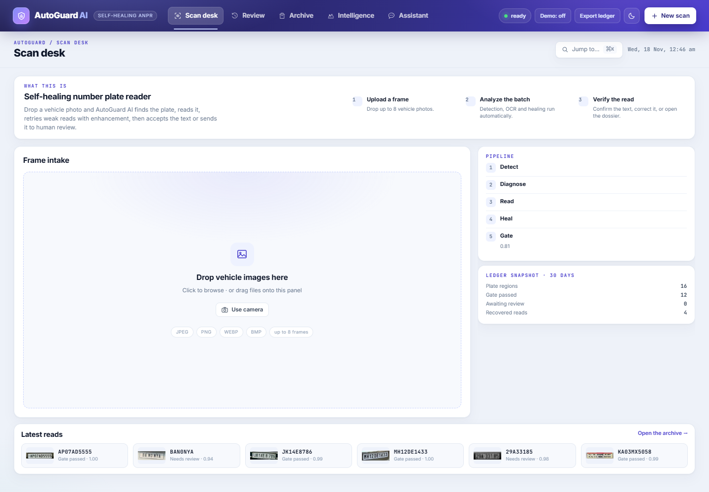
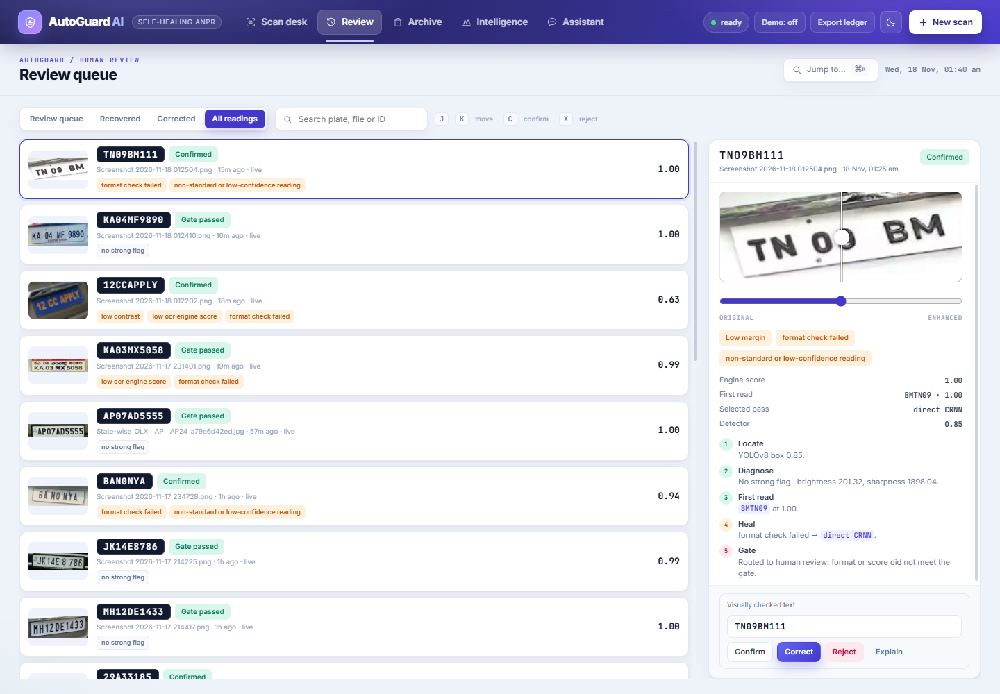
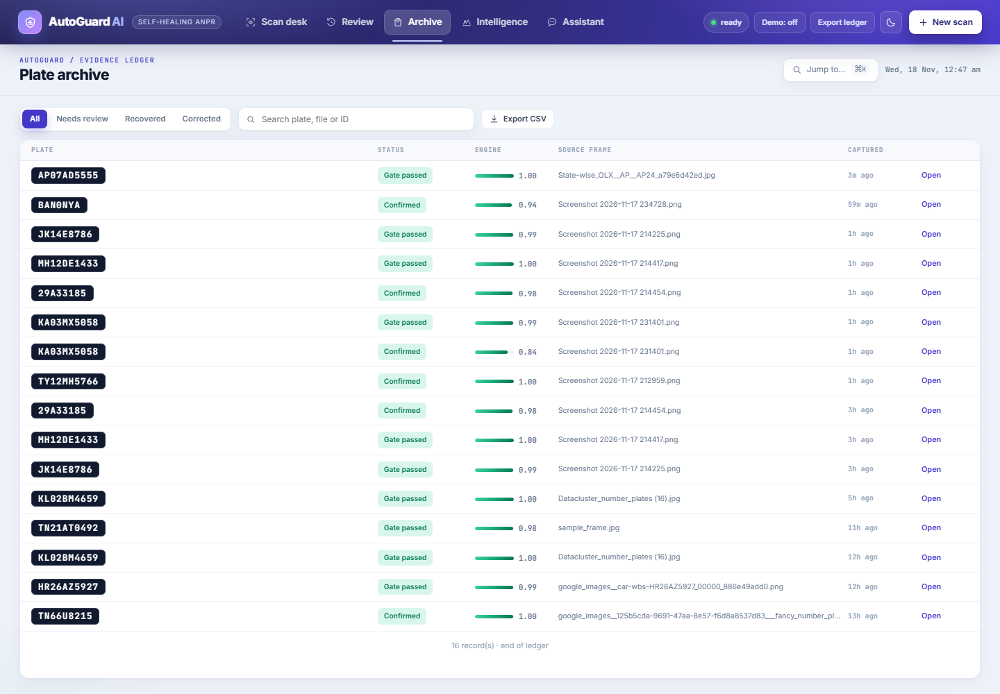
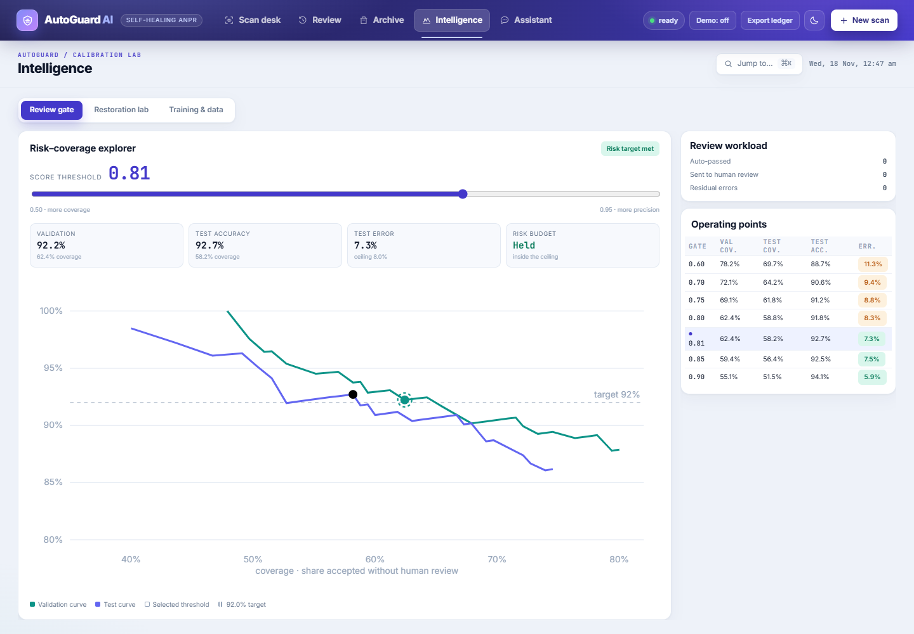
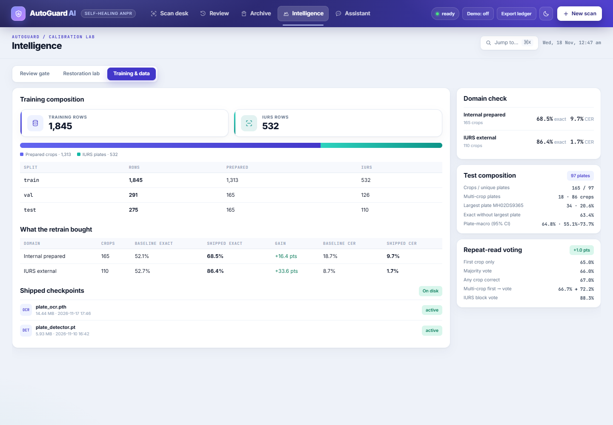
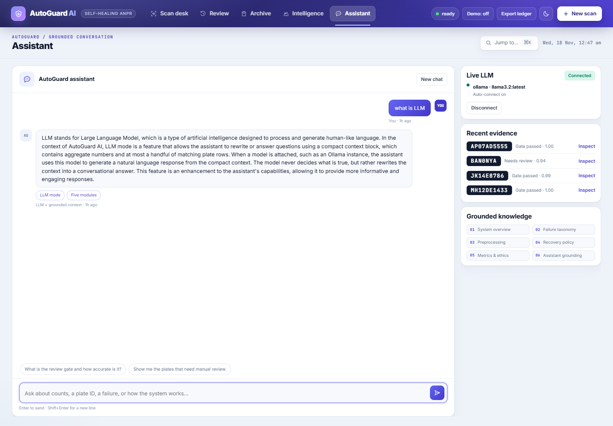
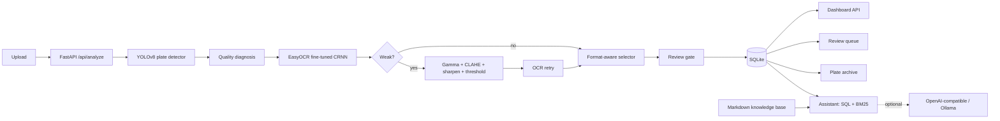

# AutoGuard AI

**An intelligent, self-healing Automatic Number Plate Recognition system with a grounded Generative AI assistant.**

AutoGuard AI is a still-image Indian ANPR capstone. It detects number plates with YOLOv8, reads them with a fine-tuned EasyOCR recogniser, diagnoses image-quality and OCR failures, retries on enhanced crops, routes uncertain readings to a human, and explains the whole process through a conversational assistant.

The important design choice is that the assistant is **not** a generic chatbot bolted onto a detector. It answers from the same SQLite database that powers the console, and it retrieves explanations from the project's own Markdown knowledge base. An LLM is optional; the system remains useful offline without one.

> **Capstone prototype, not production-ready.** The internal test split was inspected during development, so the headline numbers are development estimates. On the 165-crop test set, 41.8% of readings go to human review and 7.3% of auto-passed readings are still wrong. See [Evaluation](#evaluation-measured-with-caveats) and the [report](docs/AutoGuard_AI_Capstone_Report.pdf).



---

## What is implemented

| Module | Status | What it does |
|---|---|---|
| Plate detection | Done | YOLOv8n fine-tuned on 1,319 prepared scene images; 1280 px inference, split/duplicate box merging, padded crops, wider-context retry and frame-edge flagging. |
| OCR | Done | Fine-tuned EasyOCR CRNN, beam search, character allowlist; trained on the original crops plus 532 plate crops reconstructed from the IURS character set. |
| Quality diagnosis | Done | Brightness, contrast, Laplacian sharpness, OCR score and Indian plate format. |
| Self-healing recovery | Done | Gamma, CLAHE, unsharp mask and adaptive threshold retries; perspective rectification as an extra candidate; direct-CRNN hybrid rescue; format-aware selection. |
| Review gate | Done | Risk-calibrated on validation: common plate structure + OCR engine score ≥ 0.81 to hold selective error ≤ 8%. |
| Human verification | Done | Confirm, correct or reject any reading; corrections are stored and counted. |
| Analytics dashboard | Done | Replaced by a task-based console: scan desk, review queue, plate archive, calibration lab and assistant. |
| Risk lab | Done | Interactive risk–coverage explorer inside the Intelligence view: threshold slider, validation vs test curves, operating-point table. |
| Recovery centre | Done | The Review queue: searchable decision desk with candidate trace, before/after compare and explanations. |
| Grounded AI assistant | Done | SQL + BM25 retrieval, intent routing, optional OpenAI-compatible or Ollama generation, in-app local LLM connect. |
| Camera capture | Done | Browser camera capture feeds the same scan pipeline; files never leave the local process. |
| Persistence | Done | SQLite with `analyses`, `plates`, `chat_sessions`, `chat_messages`. |
| Demo data | Done | Clearly labelled `source='demo'` rows for an explorable first run. |
| Tests | Done | Service, RAG, assistant, pipeline (fake detector/reader) and API contract tests. |
| Documentation | Done | Architecture, API, capstone report, demo script and viva notes. |

---

## Documentation

- [`docs/DASHBOARD_GUIDE.md`](docs/DASHBOARD_GUIDE.md) — what every screen does.
- [`docs/PROJECT_STRUCTURE.md`](docs/PROJECT_STRUCTURE.md) — folder layout and cleanup rules.
- [`docs/DATASET.md`](docs/DATASET.md) — current dataset and the 8,168-image character dataset.
- [`docs/TRAINING_PLAYBOOK.md`](docs/TRAINING_PLAYBOOK.md) — local restoration and character-detector training.
- [`docs/ARCHITECTURE.md`](docs/ARCHITECTURE.md) — pipeline and data flow.
- [`docs/API.md`](docs/API.md) — endpoint reference.
- [`docs/AutoGuard_AI_Capstone_Report.pdf`](docs/AutoGuard_AI_Capstone_Report.pdf) — printable PDF of the report.
- [`docs/DEMO_SCRIPT.md`](docs/DEMO_SCRIPT.md) — demo walkthrough.
- 
```powershell
.\.venv\Scripts\python.exe scripts\build_report_pdf.py
node scripts\print_report_pdf.mjs
```

---

## Screens and workflow

Five task-based views share a gradient top navigation and a page header. A command palette (`Ctrl/Cmd + K`) jumps to any view, reading or action; `G` then `S/R/A/I/C` navigates; a light/dark toggle and a per-plate evidence dossier are available everywhere.

**Scan desk (`#/scan`)**

Drag-and-drop or camera intake; each result shows the annotated frame, padded crop, character cells, retry trace and gate decision.

**Review queue (`#/review`)**



**Plate archive (`#/archive`)**



**Intelligence (`#/intel`)**





**Assistant (`#/assistant`)**



1. **Scan desk** — drag-and-drop up to eight frames or use the camera. Each result shows the annotated frame, padded plate crop, character-cell reading with a score ring, before/after compare, quality flags, retry trace, candidate pool and a verification box. A **Latest reads** rail under the intake card shows the newest crops from the live ledger and opens any of them as a dossier; it hides on short viewports and once a batch starts. Batch results can be copied or exported as JSON.
2. **Review queue** — the human-in-the-loop desk. Filter by needs-review, recovered or decided; search by plate/file/ID; move with `j`/`k`, confirm with `c`, reject with `x`. The inspector carries the compare slider, five-step trace and one-click explain.
3. **Plate archive** — the evidence ledger for every stored reading with status, engine score, source frame and age. Open any row into the dossier drawer to verify, reopen, explain, copy the plate or export that record as JSON.
4. **Intelligence** — a risk–coverage explorer that sweeps the review threshold across validation and test curves, the experimental restoration lab (bicubic vs Real-ESRGAN vs RefineNet with OCR before/after), and a **Training & data** tab that shows the 1,845-row composition (532 IURS rows), baseline-vs-shipped gains and the exact checkpoints on disk. No vanity KPIs.
5. **Assistant** — ask about counts, failures, specific plate IDs, preprocessing, the review gate, evaluation metrics, privacy or architecture. The empty canvas offers grounded starter questions, and the sidebar lists **Recent evidence** (latest readings the assistant can cite, each opening its dossier) and **Grounded knowledge** (the indexed document sections). Data answers are grounded in SQL; technical answers are grounded in retrieved documentation. An LLM panel connects a loopback Ollama instance to compose the final answer; without it, answers come from the deterministic grounded path.

---

## Architecture



```
Browser SPA (vanilla JS, no build step)
        │  fetch JSON
        ▼
FastAPI (api/main.py)
        │
        ├── src/anpr/db.py          SQLite repository + analytics
        ├── src/anpr/assistant.py   intent routing + grounded answers
        ├── src/anpr/rag.py         BM25 over six Markdown documents
        ├── src/anpr/llm.py         optional OpenAI-compatible/Ollama client
        ├── src/anpr/pipeline.py    detector + OCR + recovery
        ├── src/anpr/selection.py   format-aware candidate selection + gate
        └── src/anpr/benchmark.py   reads reports/ and runs/ metrics
```

The ML imports are lazy. The console (scan desk, review queue, archive, intelligence and assistant) starts even on a machine where OpenCV/EasyOCR/PyTorch are not installed; only `/api/analyze` returns a clear `503` until the ML requirements are present.

---

## Quick start on Windows

### 1. Create the environment

From the repository root:

```powershell
powershell -ExecutionPolicy Bypass -File .\setup.ps1
```

Or manually:

```powershell
py -3.11 -m venv .venv
.\.venv\Scripts\python.exe -m pip install --upgrade pip
.\.venv\Scripts\python.exe -m pip install --index-url https://download.pytorch.org/whl/cpu torch torchvision
.\.venv\Scripts\python.exe -m pip install -r requirements.txt
.\.venv\Scripts\python.exe -m pip install -r requirements-dev.txt
```

### 2. Add the model checkpoints

Trained weights are binary and are not committed. Copy them into `models/` and verify them against these checksums:

| File | Bytes | SHA-256 | Role |
|---|---:|---|---|
| `plate_detector.pt` | 6,218,154 | `392f8ec03a667abfdf7f23e245e929d333aa558d0daf9dfb625ed2e48da9f0f6` | YOLOv8n plate detector (required) |
| `plate_ocr.pth` | 15,145,561 | `24aaafdd54284a598ec99f4e084a4e70636cddc1e2cb3ff726f4cbecd8299d06` | EasyOCR recogniser (required) |
| `RealESRGAN_x4plus.pth` | 67,040,969 | `4fa0d38905f75ac06eb49a7951b426670021be3018265fd191d2125df9d682f1` | restoration lab only (optional) |

Without the first two the app falls back to pretrained EasyOCR and YOLOv8n, which read Indian plates poorly. The training sections below reproduce both checkpoints from the prepared dataset.

### 3. Start the app

```powershell
.\run.ps1
```

Or directly:

```powershell
.\.venv\Scripts\python.exe -m uvicorn api.main:app --host 127.0.0.1 --port 8000
```

Open **http://127.0.0.1:8000**.

### 4. Optional: seed demo data

The console looks empty on a fresh database. Seed clearly labelled synthetic rows:

```powershell
.\.venv\Scripts\python.exe scripts\seed_demo.py --days 21
```

Remove them at any time:

```powershell
.\.venv\Scripts\python.exe scripts\seed_demo.py --clear
```

Demo rows carry `source='demo'`. The top navigation's **Demo data** toggle includes or excludes them everywhere; they are never counted as an evaluation result.

### 5. Verify without the ML stack

```powershell
.\.venv\Scripts\python.exe scripts\selfcheck.py
.\.venv\Scripts\python.exe -m unittest discover -s tests -v
```

`selfcheck.py` exercises the database, analytics, verification, RAG index and assistant with no FastAPI, OpenCV or model downloads.

---

## Using the assistant

Open **AI assistant** and try:

- *How many vehicles were analysed today?*
- *Show me the plates that need manual review.*
- *Which readings had low OCR confidence?*
- *Show me all successfully recovered number plates.*
- *Why did plate 12 fail?*
- *What preprocessing was applied to it?*
- *What is the review gate and how accurate is it?*
- *What happens to my uploaded image?*

### Local mode (default)

With no model configured, the assistant:

1. classifies the intent with transparent rules,
2. queries SQLite for facts,
3. retrieves relevant sections from `src/anpr/knowledge/*.md` with BM25,
4. writes a deterministic grounded answer.

This is the mode you can demonstrate offline. It cannot invent a model key, and it still answers every question in the list above.

### LLM mode (optional)

Set an OpenAI-compatible endpoint:

```powershell
$env:AUTOGUARD_LLM_API_KEY = "sk-..."
$env:AUTOGUARD_LLM_BASE_URL = "https://api.openai.com/v1"
$env:AUTOGUARD_LLM_MODEL = "gpt-4o-mini"
.\.venv\Scripts\python.exe -m uvicorn api.main:app --port 8000
```

Or use local Ollama:

```powershell
$env:AUTOGUARD_OLLAMA_URL = "http://127.0.0.1:11434"
$env:AUTOGUARD_OLLAMA_MODEL = "llama3.2"
```

In `auto` mode (default) the model answers technical/explanatory questions from the full retrieved documentation, with the deterministic draft as a correctness check; data answers stay SQL-grounded. `AUTOGUARD_LLM_MODE=always` sends every answer through the model, and `off` disables it. A failed or timed-out call (default `AUTOGUARD_LLM_TIMEOUT=90` seconds) returns the deterministic answer labelled as a local fallback. Without a model the assistant still explains itself and quotes the relevant sections.

**Persistent connection:** with Ollama running and at least one model pulled, the assistant attaches by itself within about 15 seconds — no click required, and it reattaches after an Ollama restart. The sidebar shows the auto-connect state; **Disconnect** pauses it until **Connect** is used again. Point the probe at another loopback port with `AUTOGUARD_OLLAMA_URL` (remote hosts are only accepted through that environment variable, never through the UI).

Only aggregate data and a handful of matching plate rows are sent to a hosted model. Uploaded images are never sent.

---

## API

| Method | Path | Purpose |
|---|---|---|
| `GET` | `/api/health` | App, database, detector and feature status. |
| `POST` | `/api/analyze` | Upload an image; returns annotated preview, plates, trace and stored IDs. |
| `GET` | `/api/analytics/summary?days=30&include_demo=1` | KPI metrics. |
| `GET` | `/api/analytics/timeseries?days=14` | Daily activity. |
| `GET` | `/api/analytics/breakdown?days=30` | Failure, recovery and method breakdowns. |
| `GET` | `/api/analytics/benchmark` | OCR test metrics + detector validation metrics. |
| `GET` | `/api/analytics/export?days=30` | CSV export of plate records. |
| `GET` | `/api/plates?status=review&q=&limit=20&offset=0` | Filtered plate list. |
| `GET` | `/api/plates/{id}` | One plate record. |
| `POST` | `/api/plates/{id}/verify` | `{verified_text, status}` where status is confirmed/corrected/rejected. |
| `GET` | `/api/plates/{id}/explain` | Structured failure explanation. |
| `POST` | `/api/assistant/chat` | `{message, session_id?}`; returns grounded reply, citations and plate cards. |
| `GET` | `/api/assistant/session/{id}` | Persisted chat history. |
| `GET` | `/api/assistant/status` | Local/LLM mode, auto-connect state and indexed knowledge size. |
| `GET` | `/api/assistant/detect?url=` | Probe a loopback Ollama server and list installed models. |
| `POST` | `/api/assistant/llm` | `{provider: "ollama"|"off", url?, model?}`; connect, or pause auto-connect. |
| `POST` | `/api/demo/seed` | Seed demo rows (`confirm=true`). |
| `DELETE` | `/api/demo` | Remove demo rows. |

Full request/response examples are in [`docs/API.md`](docs/API.md).

---

## Database

SQLite file: `data/autoguard.db` (override with `AUTOGUARD_DB`).

- `analyses` — one row per uploaded image: filename, source (`upload`/`demo`/`benchmark`), hash, dimensions, plate count, processing time.
- `plates` — one row per detected plate: machine/original text, scores, review status, quality flags, retry details, candidates, observations, crop preview, human verification, optional ground truth.
- `chat_sessions` / `chat_messages` — persisted assistant conversations and structured citations/plate cards.

The full schema is in [`docs/ARCHITECTURE.md`](docs/ARCHITECTURE.md).

---

## Evaluation (measured, with caveats)

The project has two separate evaluations: detector localization and OCR crops. They must not be conflated.

### Detector (validation, final epoch)

| Metric | Value |
|---|---:|
| Precision | 98.68% |
| Recall | 100.00% |
| mAP50 | 99.31% |
| mAP50-95 | 83.99% |

These are YOLO validation metrics from training, not an independent test-set claim.

### OCR on 165 held-out crops (internal development estimate)

| Metric | Baseline (no rescue) | Hybrid rescue |
|---|---:|---:|
| Test exact match | 52.12% | **68.48%** |
| Test character error rate | 18.68% | **9.72%** |
| Validation exact match | 63.64% | **76.36%** |
| Validation character error rate | 17.02% | **8.64%** |

**Source of truth.** These four values come from one frozen run: `reports/ocr_val_v2.csv` and `reports/ocr_final_test_v2.csv`, using the `margin_0.25` columns that match the shipped selector (`DEFAULT_RETRY_MARGIN = 0.25` in `src/anpr/selection.py`). `scripts/evaluate_final.py` aggregates the test rows into `reports/final_evaluation.json`. Other margins in the same files (for example 69.09% / 9.66% at margin 0.05 and 68.48% / 9.78% at margin 0.20) are sensitivity checks, not the shipped operating point.

These are the numbers for the currently shipped checkpoint (`models/plate_ocr.pth`, the combined-data retrain) evaluated through the full pipeline, which includes the perspective-rectification candidate and per-row candidates. The hybrid rescue is a conservative inference-time ensemble. If the detector + OCR base reading is already common-format with an engine score of at least **0.55**, it is kept. Otherwise the pipeline adds direct-CRNN readings (bypassing EasyOCR's text detector), cyclic rotations that satisfy the Indian plate structure and a rectified perspective candidate, then re-runs the format-aware selector. Every detected row of at least eight characters is also its own candidate, so a stray logo row cannot destroy a clean plate row. Against the first-pass reading this pool recovered **28 additional exact rows with 1 loss** on test and **21 with 0 losses** on validation; the row-level columns `original_exact_match` and `margin_0.25_exact_match` in `reports/ocr_final_test_v2.csv` and `reports/ocr_val_v2.csv` make both counts reproducible.

Review gate after rescue: the threshold is not hand-picked. `scripts/calibrate_gate.py` sweeps acceptance thresholds on the **validation** split, applies the fixed Indian plate structure, and selects the lowest threshold that keeps selective error within an 8% risk budget. That produced **0.81**, which is frozen and replayed with `--threshold 0.81`. On the **test** split this yields **58.2% coverage** and **92.7% selective accuracy** (7.3% selective error), while validation gives 62.4% coverage and 92.2% selective accuracy. The test curve is inspected only after selection; the risk target held on both splits. Re-selecting on the updated validation predictions would pick 0.78, which exceeds the 8% budget on test — the reason the operating point stays frozen instead of being re-tuned. The Intelligence view replays this curve interactively; the assistant explains the difference between exact match, CER, gate coverage and selective accuracy. The exact 0.81 point is stored in `reports/gate_curve.json` (`recommended` on validation, `test_at_recommended` on test); the coarser 0.80 row in `reports/final_evaluation.json` (58.79% / 91.75%) is a sweep sample, not the frozen gate.

**Uncertainty and workload.** A point estimate on 165 crops hides its own error bar. The 95% Wilson interval for the 68.48% headline is **61.04–75.08%**; character similarity (1 − CER) is **90.28%**. Per 100 plates the shipped gate auto-passes **58.2**, sends **41.8** to human review and leaves **4.24** residual errors. The IURS domain check (110 held-out IURS crops) reads **86.36% exact at 1.72% CER (95% CI 78.71–91.56%)**, with 66.4/33.6/3.64 per 100 at the same gate. IURS rows were also used in training, so this is a within-source domain check, not an independent validation set.

**Composition and repeated reads.** The 165 crops contain **97 unique plates**. The largest plate (MH02DS9365) supplies 34 crops (20.6% of the test), so the console also reports a per-plate macro average of **64.77% (95% CI 55.10–73.65%)** and accuracy without that plate (**63.36%**). On the 18 multi-crop vehicles, a character-wise majority vote lifts first-crop accuracy from **66.7% to 72.2%** (77.8% if any crop is correct). `scripts/eval_frame_vote.py` measures this offline; it is **not** wired into the production path.

**Caveat:** the test split was inspected during development and thresholds were iterated, so these are development results rather than a pristine final benchmark. The external DataCluster sample was much harder: 40% exact match / 24.68% CER on 25 crops under the earlier policy. That is a generalisation warning, not a population estimate; the new rescue has not been re-run on it.

The console displays these numbers with the caveat; the assistant explains the difference between exact match, CER, gate coverage and selective accuracy.

---

## Dataset and training

The raw folders live beside this project in `C:\Users\suraa\Desktop\ANPR2`: `google_images`, `State-wise_OLX`, `video_images`. Raw images and XML are not modified.

The preparation script found 1,697 XML annotations and 1,698 image files. It removed 47 exact duplicate image copies, resolved the stale `ML39.xml` filename, and excluded the orphan `MH5.xml`, leaving 1,649 scene images:

| Split | Full images | Plate crops | Unique OCR labels |
|---|---:|---:|---:|
| Train | 1,319 | 1,313 | 784 |
| Validation | 165 | 165 | 96 |
| Test | 165 | 165 | 97 |

The original prepared split is grouped by normalized plate text and exact image hash; train, validation and test share no plate text (verified: 0 overlap in all three pairs). Three model-name boxes (CRETA, DUSTER, TERRANO) are kept as negative detector examples. `BLUR` and `HP2020TR6255G` are excluded from OCR training and listed for review.

On top of this set, 694 plates (768 single-line rows) were reconstructed from the IURS character-detection archive described in [`docs/DATASET.md`](docs/DATASET.md); 532 rows are used for training, 126 for validation and 110 for the reported check. No full plate text is shared with the original prepared split (0 overlap between IURS test strings and prepared train). Eight IURS test crops carry degenerate fragments (`GJ01`, `GJ01T`, `GJ18`, `GJ27T`) that also occur in IURS training rows; they stay in the evaluation, and they are why the 110-crop figure is reported as a domain check rather than an independent test. `scripts/combine_ocr_datasets.py` merges both sources into `data/combined_ocr/` for recogniser training. Model selection uses the combined validation split; every reported accuracy number is still measured on the original plate-level test split only, because the IURS crops are clean frontal plates and would flatter the result.

The source folder has no license/provenance document. Keep the dataset local for this academic project unless reuse and redistribution terms are confirmed.

### Prepare and train the detector

```powershell
.\.venv\Scripts\python.exe scripts\prepare_dataset.py
.\.venv\Scripts\python.exe train_detector.py --epochs 30 --device cpu
.\.venv\Scripts\python.exe evaluate_detector.py --device cpu
```

The detector starts from pretrained YOLOv8n weights and selects its best checkpoint on validation data.

### Fine-tune OCR

```powershell
.\.venv\Scripts\python.exe scripts\prepare_iurs_plates.py
.\.venv\Scripts\python.exe scripts\combine_ocr_datasets.py
.\.venv\Scripts\python.exe train_ocr.py --data-root . `
  --train-csv data\combined_ocr\train.csv --val-csv data\combined_ocr\val.csv `
  --epochs 10 --batch 16 --patience 3 --resume-from models\plate_ocr.pth `
  --checkpoint models\plate_ocr_v2.pth --history-output reports\ocr_v2_history.json
```

`scripts/prepare_iurs_plates.py` rebuilds plate-level crops from the IURS character boxes (details in [`docs/DATASET.md`](docs/DATASET.md)); `scripts/combine_ocr_datasets.py` merges them with the original crops. The retrain starts from the shipped checkpoint, so it only adds to what the model already knows. It writes `models/plate_ocr_v2.pth` and does not touch the shipped `models/plate_ocr.pth`; promote it only if it wins on the held-out evaluation:

```powershell
Copy-Item models\plate_ocr.pth models\attic\plate_ocr_pre_v2.pth -Force
Copy-Item models\plate_ocr_v2.pth models\plate_ocr.pth -Force
```

This promotion happened: the retrain (best epoch 4, combined-val CER 0.0955) moved test exact match from 66.67% to **68.48%** and CER from 11.16% to **9.72%** under the same evaluator, and also raised gate coverage without lowering selective accuracy. The pre-v2 weights are kept at `models/attic/plate_ocr_pre_v2.pth`; the evaluator report is `reports/ocr_rect_test_v2.json`. The intermediate `models/plate_ocr_v2.pth` was byte-identical to the promoted checkpoint, so it has been removed; rerunning the retrain recreates it.

The API loads the fine-tuned recogniser automatically when the file exists; otherwise it uses pretrained EasyOCR.

### Evaluate OCR and recovery

```powershell
.\.venv\Scripts\python.exe evaluate_ocr_crops.py `
  --data-root data\prepared_corrected `
  --csv data\prepared_corrected\ocr\test.csv `
  --output reports\ocr_final_test_v2.csv --margins 0.25
```

The evaluator uses the same enhancement, ordering, rectification and selection code as the app. Per-crop predictions and a JSON summary are written beside the CSV.

### Perspective rectification

`src/anpr/rectify.py` estimates the plate quadrilateral (Canny edges, then an Otsu-binary fallback) and warps it to a rectangle. The warped copy is only ever **added as an extra OCR candidate**; the original crop is never replaced.

```powershell
.\.venv\Scripts\python.exe scripts\evaluate_rectify.py --csv data\prepared_corrected\ocr\val.csv --output reports\rectify_val_v2.json
.\.venv\Scripts\python.exe scripts\evaluate_rectify.py --csv data\prepared_corrected\ocr\test.csv --output reports\rectify_test_v2.json
```

Measured with the pre-v2 checkpoint: validation exact match **72.12% → 75.15%** (165 crops; 6 gained, 1 lost) and test **66.06% → 66.67%** (165 crops; 2 gained, 1 lost). Re-checked with the shipped v2 checkpoint: validation **70.30% → 75.15%** (8 gained, 0 lost) and test **68.48% → 68.48%** (1 gained, 1 lost). These are rectification-off-versus-on ablation numbers, not the headline validation score (76.36%). It stays in the pipeline because it is clearly positive on validation and neutral (not harmful) on test; the reports keep both the wins and the loss rather than hiding them. These ablation numbers predate the per-row candidate addition. `scripts/evaluate_rectify.py` can be pointed at the combined manifests to re-check it after any future model change.

### Cold test protocol

The internal test split was inspected during development, so it cannot be a pristine benchmark. The cold-test tooling freezes and hash-locks a label file, and scores only rows a human has explicitly verified:

```powershell
.\.venv\Scripts\python.exe scripts\cold_test.py freeze
# open scripts\label_tool.html in a browser, load data\cold_test\labels.csv
# and the folder data\prepared_corrected\ocr\test\images, then export labels.csv
.\.venv\Scripts\python.exe scripts\cold_test.py lock
.\.venv\Scripts\python.exe scripts\cold_test.py run --predictions reports\ocr_final_test_v2.csv
```

`run` refuses to execute if the label file changed after locking, and reports frame exact match, plate-macro exact match, Wilson interval and review-gate coverage/selective accuracy.

### Rolling back

A verbatim pre-v2 snapshot of the code lives in `attic/pre_v2_20261117/` with restore instructions in `attic/pre_v2_20261117/RESTORE.md`; the previous recogniser is backed up at `models/attic/plate_ocr_pre_v2.pth`. Both folders are local-only and excluded from git.

### Corrected labels

`scripts/prepare_dataset.py` applies the reviewed corrections when preparing data:

- `State-wise_OLX/DL/DL30.jpg` uses the user-verified text `DL10C0S520`.
- `State-wise_OLX/AN/AN2.jpg` and `AN6.jpg` retain XML box coordinates without rescaling because the declared XML dimensions do not match the image files; visual review confirmed the raw coordinates align with the plates.

The reviewed copy is `data/prepared_corrected`.

---

## Project structure

```
self-healing-anpr/
├── api/
│   └── main.py                 FastAPI app + all endpoints
├── src/anpr/
│   ├── pipeline.py             YOLO + EasyOCR + self-healing recovery
│   ├── rectify.py              plate quadrilateral detection + perspective warp
│   ├── recovery.py             conservative direct-CRNN / rotation / row-candidate rescue
│   ├── selection.py            format-aware candidate selection + review gate
│   ├── db.py                   SQLite schema, repository, analytics, demo seed
│   ├── assistant.py            intent routing, grounded answers, LLM polish
│   ├── rag.py                  dependency-free BM25 retrieval
│   ├── llm.py                  OpenAI-compatible / Ollama client
│   ├── benchmark.py            reads measured evaluation artefacts
│   ├── config.py               env-driven configuration
│   └── knowledge/              six Markdown documents used by RAG
├── web/
│   ├── index.html              console shell (top navigation, page header, view roots)
│   ├── console.css             single design-system layer: light/dark tokens, views, components
│   └── app.js                  scan, review, archive, intelligence and assistant SPA
├── scripts/
│   ├── seed_demo.py            seed/clear labelled demo rows
│   ├── selfcheck.py            offline service-layer check
│   ├── prepare_dataset.py      dataset preparation
│   ├── prepare_iurs_plates.py  rebuild plate crops from IURS character boxes
│   ├── combine_ocr_datasets.py merge original + IURS manifests
│   ├── calibrate_gate.py       validation-only risk calibration → gate curves
│   ├── evaluate_final.py       composition-aware evaluation (frame, plate-macro, gate)
│   ├── eval_frame_vote.py      character-wise majority vote across repeated reads
│   ├── evaluate_rectify.py     measure rectification as an extra candidate
│   ├── error_report.py         visual failure report
│   ├── cold_test.py            frozen, hash-locked cold-test protocol
│   ├── build_report_pdf.py     render the capstone report Markdown as print HTML
│   ├── print_report_pdf.mjs    print that HTML to docs/AutoGuard_AI_Capstone_Report.pdf
│   └── label_tool.html         offline label verification page
├── tests/
│   ├── test_services.py        DB, analytics, RAG, assistant
│   ├── test_pipeline.py        fake detector/reader pipeline integration
│   ├── test_recovery.py        hybrid rescue policy
│   ├── test_benchmark.py       intervals, workload and report composition
│   └── test_api.py             FastAPI contract tests
├── models/                     trained checkpoints (not committed; copy plate_ocr.pth + plate_detector.pt here)
├── reports/                    evaluation CSVs + JSON, gate_curve.json
├── runs/                       detector training summary (results.csv, args.yaml)
├── data/                       committed manifests + local dataset and app DB
├── docs/                       architecture, API, report, demo, viva, screenshots
├── requirements.txt
├── requirements-dev.txt
├── setup.ps1
├── run.ps1
└── README.md
```

Local-only folders (`attic/`, `models/attic/`, `data/prepared_corrected/`, `data/iurs_plates/`) are excluded by `.gitignore`.

---

## Testing

```powershell
.\.venv\Scripts\python.exe -m unittest discover -s tests -v
```

- `test_services.py` runs with the standard library only.
- `test_pipeline.py` needs OpenCV/NumPy and uses an injected fake detector/reader, so it does not download models.
- `test_recovery.py` checks the trust guard, rotation variants, row-candidate survival and rescue selection.
- `test_api.py` needs FastAPI/httpx and uses a temporary SQLite database.

If you use pytest:

```powershell
.\.venv\Scripts\python.exe -m pytest tests -q
```

## License and attribution

The code is released under the MIT licence — see [`LICENSE`](LICENSE). Model weights and datasets are **not** covered by that licence and are not redistributed in this repository. The bundled dataset has no confirmed redistribution licence; keep it local. The external DataCluster sample is CC BY-NC-ND 4.0 for academic, non-commercial evaluation with attribution. The IURS ANPRIND archive is CC BY 4.0; the reconstructed crops are used locally for training only.
